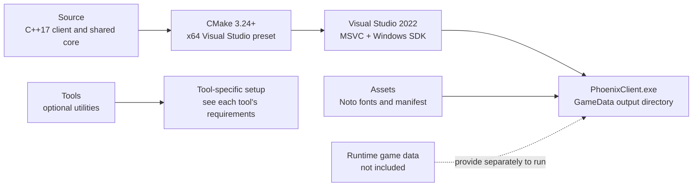

<div align="center">

# DK Phoenix Reborn

### A modern Windows client and toolset for the DK Phoenix Reborn project


**A source-first Windows project for rebuilding the client and its supporting tools with a current Microsoft toolchain.**

</div>

> [!IMPORTANT]
> **The current source snapshot does not configure successfully yet.** The top-level CMake file still refers to Map Editor sources under `Tool/MapEditor/`, while the available files are under `Tools/MapEditor/`. A clean CMake generation reports missing source files. This repository preserves the supplied source state and does not silently rewrite those project paths; see [Known build limitation](#known-build-limitation) before attempting a build.

## At a glance

| Area | Details |
|---|---|
| **Client** | C++17 Windows client, configured for 64-bit builds |
| **Graphics** | Direct3D 11, DXGI, Direct2D, DirectWrite, and Windows Imaging Component |
| **Build system** | CMake presets with the Visual Studio 2022 generator |
| **Runtime assets** | Not included; `GameData/` is intentionally excluded from Git |
| **Optional tools** | Supporting source and setup files are included, except the excluded Sprite UI Layout Tool |



## Build requirements

- Windows 10 or Windows 11
- Visual Studio 2022 with the **Desktop development with C++** workload
- MSVC x64 build tools and a Windows 10/11 SDK
- CMake 3.24 or newer
- PowerShell
- Git, to clone the repository

The top-level C++ client uses Windows SDK libraries, including Direct3D 11, DXGI, Direct2D, DirectWrite, Windows Imaging Component, WinMM, and Winsock. The CMake configuration does not declare a vcpkg manifest for the main client.

## Get the source

In PowerShell:

```powershell
git clone https://github.com/dkcommunity/DK-Phoenix-Reborn.git
Set-Location .\DK-Phoenix-Reborn
```

Install the requirements above before configuring. CMake detects the Visual Studio installation and uses the `windows-vs2022-x64` preset to select the x64 generator and build directory.

## Configure and build

The intended Release build commands are:

```powershell
cmake --preset windows-vs2022-x64
cmake --build --preset windows-vs2022-x64-release --target PhoenixClient --parallel
```

For a Debug build:

```powershell
cmake --preset windows-vs2022-x64
cmake --build --preset windows-vs2022-x64-debug --target PhoenixClient --parallel
```

The repository also includes PowerShell wrappers:

```powershell
.\Build-Release.ps1
.\Build-Debug.ps1
```

The generated Visual Studio solution is under `Build\windows-vs2022-x64`. You can open it in Visual Studio after successful CMake configuration, or open the repository folder in Visual Studio to use its CMake integration.

## Known build limitation

The current top-level `CMakeLists.txt` lists multiple Map Editor source files using the old `Tool/MapEditor/` directory. In this snapshot, those files are under `Tools/MapEditor/`; the old paths do not exist. A clean configure was checked with Visual Studio 2022 and currently fails during CMake generation with missing-source errors for `EditorWorldDrawListBuilder.cpp` and `EditorPhoenixDiagnostics.cpp`.

Consequently, the build commands above document the intended workflow but will not complete from a clean checkout until the CMake source paths and related project references are reconciled. The current source was intentionally published without changing those paths.

## Runtime data and output

The build configuration creates `GameData/` and copies `Source/World/Data/TILE.IDX` into `GameData/data/Info/`. The large runtime asset collection is not part of this repository. A successful compile alone therefore does not provide a complete playable installation; obtain the runtime data separately from a source you are authorized to use.

Build products are written under the ignored `Build/` directory and the `GameData/` output directory. Generated CMake files, executables, debug symbols, and intermediate objects are not source dependencies and should be recreated locally.

## Repository layout

```text
.
├── Assets/                 # Font assets, manifest, and test strings
├── Source/                 # Client, shared core, and tests
├── ThirdParty/             # Third-party notices and licenses
├── Tools/                  # Optional utilities and editor source
├── CMakeLists.txt          # Main client and tool targets
├── CMakePresets.json        # Visual Studio 2022 x64 presets
├── Build-Release.ps1        # Release build helper
└── Build-Debug.ps1          # Debug build helper
```

The following paths are intentionally excluded: `Docs/`, `Logs/`, `TempVerify/`, `GameData/`, and `Tools/SpriteUILayoutTool/`. Existing ignore rules also keep generated build output and local IDE state out of version control.

## Optional Python tools

Python-based utilities are independent of the C++ client build. Use each tool's own `README.md` and `requirements.txt`, if present, to create a fresh virtual environment on your computer. Local `.venv/` directories are not portable and are excluded.

## Third-party assets and licenses

The repository includes Noto font assets and their license notices under `ThirdParty/Licenses/Fonts/Noto/`. Review the applicable license before redistributing assets or binaries. Runtime game data is excluded and is not covered by the font notices.

---

<div align="center">

**DK Phoenix Reborn · Windows x64 · C++17**

</div>
